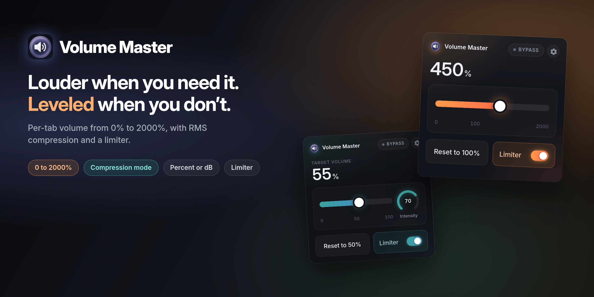
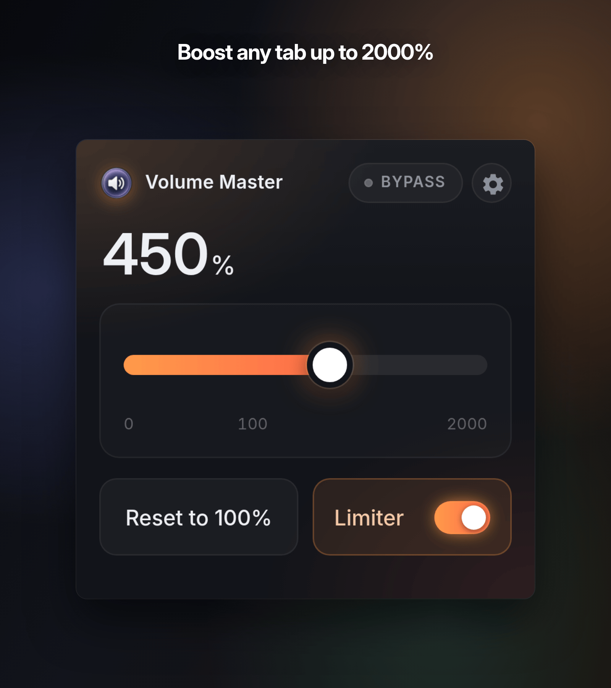
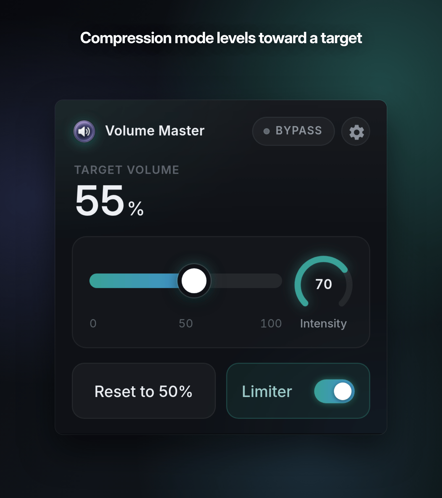
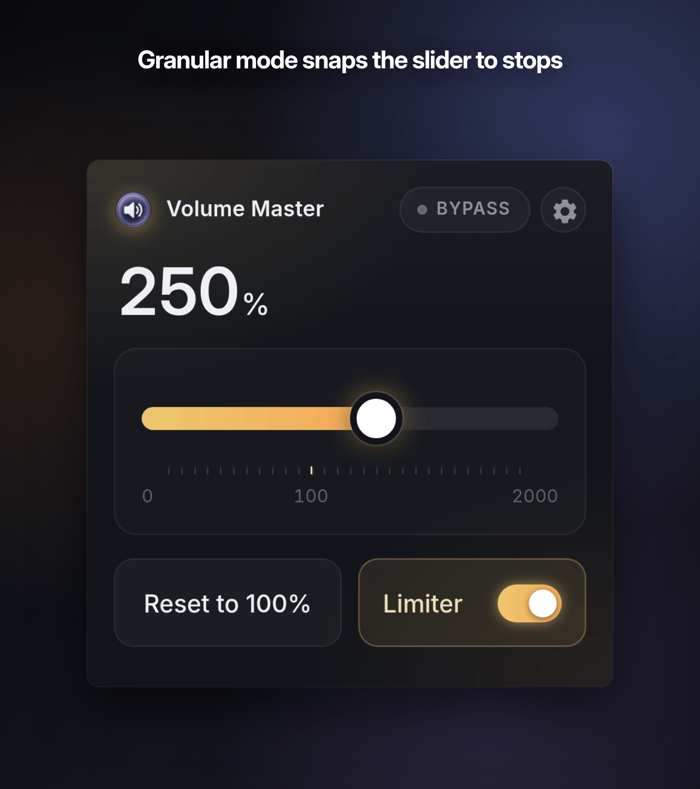
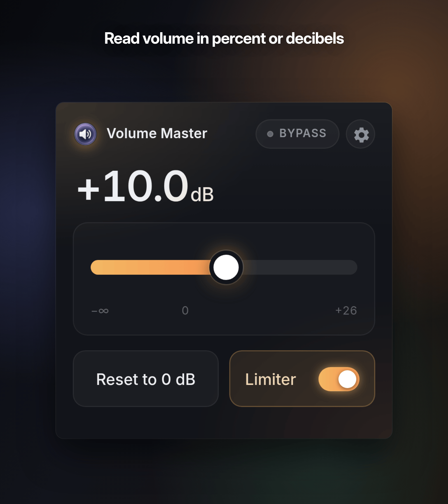

<p align="center">
  
</p>

# Volume Master

<p align="center">
  <a href="https://chromewebstore.google.com/detail/eodlhjkbanpiojkkpbkapolaglepomkp"></a>
</p>

Per-tab volume control for Chrome, from 0% to 2000%.

## Features

<table>
  <tr>
    <td align="center" width="50%">
      
      <p>Set volume on one tab from 0% to 2000%, where 100% is native.</p>
    </td>
    <td align="center" width="50%">
      
      <p>Compression mode levels toward a target RMS volume, with an Intensity knob.</p>
    </td>
  </tr>
  <tr>
    <td align="center" width="50%">
      
      <p>Granular mode snaps the slider to preset stops.</p>
    </td>
    <td align="center" width="50%">
      
      <p>Volume can be shown in percent or decibels.</p>
    </td>
  </tr>
</table>

Bypass leaves a tab uncaptured until you move a control. Saved values return when capture resumes. The peak limiter at the end of the chain is on by default.

## Install

**From the store.** Open the [Chrome Web Store listing](https://chromewebstore.google.com/detail/eodlhjkbanpiojkkpbkapolaglepomkp) and add the extension.

**From source.** Build first. The Develop section has the commands. Then in `chrome://extensions` turn on Developer mode, choose **Load unpacked**, and select the `dist/` folder.

## Develop

```bash
npm install
npm run build
```

Output lands in `dist/`. Load that folder as an unpacked extension. After a change, run `npm run build` again. Then reload the extension in `chrome://extensions`.

`npm run watch` recompiles TypeScript on save. `npm run package` builds and writes a zip next to the project root.

## Release

Bump `version` in both `manifest.json` and `package.json`. Merge the change to `main`. The Release workflow tags the commit and publishes the zip as a GitHub Release.
